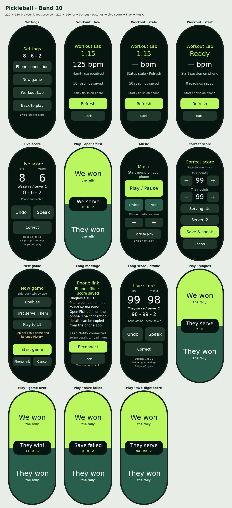

# Pickleball Lab: experimental workout recording

This branch adds a **phone-based workout and heart-rate compatibility test** to the working Xiaomi Smart Band 10 Pickleball apps. It does not start a native band workout. Lab 1 established that heart-rate sharing locks the tested band to its sharing screen. Lab 2 tests phone-side Notify events as an alternative.

The experimental APK and RPK are **additional assets on the [v0.1.11 release](https://github.com/mahmoodw/pickleball-band/releases/tag/v0.1.11)**. Regular v0.1.11 assets remain available. For a new Lab installation, use both files containing `0.1.11-workout.2`; they appear as **Pickleball Lab** and use the separate package `com.wmahmood.pickleball.workout`. They can coexist with the regular apps and have their own settings and saved game. Source is on `experimental/workout`, tagged `workout-0.1.11-exp2`.

## Result of the first device test

The Bluetooth reader works: the user's Band 10 supplied **23 HR readings** while its **Heart rate sharing** screen was open. Leaving that screen turns sharing off and disconnects the HR client. This does **not** solve scoring alongside heart-rate tracking. During a separate timer-only test, Notify carried 15 status queries and 6 score messages, so Interconnect is working.

## Try Lab 2: Notify events

**Only the phone APK needs updating** from Lab 1; its band app is compatible. The matching Lab 2 RPK is also included as an additional asset. Both use the same Lab package and certificate as before; install updates in place to retain Lab settings and recordings. Regular Pickleball remains a separate app.

1. Install `pickleball-phone-0.1.11-workout.2.apk`. Keep the Lab announcer and Notify connected, and open Pickleball Lab on the band. Leave **Heart rate sharing off** and do not start a native workout.
2. In **Notify → Smart assistant → Tasker integration**, enable integration. Tasker itself is not needed. Enable normal heart monitoring in Notify; choose **Notify app mode** if your version offers it. Use a supported interval that will produce a new reading during the test, such as one minute. The Lab app does not change these settings or issue heart-monitor start/stop commands.
3. On the phone, open **Workout Lab → Use Notify events (test) → Start test session → Test Notify events**. The last button sends only Notify's documented battery-read request to check event delivery. If you configured a command password in Notify, this request may be ignored; the Lab app does not request or transmit your password.
4. Keep using Pickleball on the band for at least two monitoring intervals. **Notify HR events** and **Notify other events** are counted separately. Battery/connection messages never become HR samples. New events can update the existing band **Settings → Workout Lab** screen.
5. **Finish session**, then use **Copy workout diagnostics**. If needed, export the diagnostic CSV. Notify HR values are stored with phone receipt time; their actual measurement time is unknown, so they are **excluded from TCX**.

This is a **compatibility probe**, not a confirmed solution. [Notify's current Xiaomi API page](https://www.mibandnotify.com/help/tasker_xiaomi_help.php) documents the integration, battery events and heart-monitor commands, but does **not** list a heart-rate event. The probed `com.mc.xiaomi.heartRateGot` and legacy `com.mc.miband.heartRateGot` actions come from community examples; another project reported unreliable delivery. Registered listeners and sent commands do not establish support. There are no direct BLE connections in Notify mode.

If other events arrive but HR does not, the missing capability is HR event delivery (or a missing fresh Notify measurement), not the scoring bridge. If no events arrive, that result cannot distinguish unsupported/directed events, disabled integration or restrictions on delivery. Keep the regular app available; the experiment does not replace it.

See [test details and interpretation](docs/WORKOUT-LAB.md).

## What this version records

- Session elapsed time using Android's monotonic clock.
- Actual received heart-rate values, at most one saved sample per second. Notify reports are distinguished from Bluetooth sensor packets in the CSV. Repeated BPM values from fresh packets are valid; no packets means no new samples.
- Received score snapshots and actions in a diagnostic CSV, plus band visibility reports and connection probes. This is not a complete offline rally history: reconnect sync contains the latest score only.
- A separate file for each session, saved privately on the phone. Samples are appended and synced to storage. After process interruption, the file remains exportable; duration ends at the last saved event, and recording does not automatically restart.

**No native Xiaomi workout is created.** Steps, GPS, calories, training load and recovery are not measured. The band RPK does not use an undocumented heart-rate API or keep its display awake.

After finishing a session, use **Export session as TCX** for manual import into Notify, or **Export diagnostic CSV** to inspect sample timing. TCX uses `Other` as its sport. Its required distance/calorie fields are zero placeholders, explicitly described in the activity notes. HR gaps remain gaps. Notify compatibility events are excluded from TCX because their measurement timestamps are not supplied; they remain in the diagnostic CSV. Notify import on this exact app/model combination still needs a real-device check; no background database insertion is implemented. Export requires choosing a destination and never uploads data automatically.

## Existing Pickleball controls

The score rules, turnover speech, correction/undo, large rally buttons, center tap/hold gestures, music controls and announcement-volume options are inherited from v0.1.11. The only added band navigation is **Settings → Workout Lab**. See the [regular app guide](https://github.com/mahmoodw/pickleball-band/blob/v0.1.11/README.md) for those features.



## Build and validation

Requires JDK 17, Android platform 35, build-tools 35.0.0, Node 24, and the locked `aiot-toolkit` 2.0.5. Android uses platform APIs and the pinned Notify SDK; no Gradle or AndroidX.

```sh
python3 scripts/fetch_notify_sdk.py
cd band
npm ci
cd ..
export PICKLEBALL_JDK=/path/to/jdk-17
export PICKLEBALL_ANDROID_PLATFORM=/path/to/android-sdk/platforms/android-35
export PICKLEBALL_ANDROID_TOOLS=/path/to/android-sdk/build-tools/35.0.0
python3 scripts/build_android.py
cd band
npm run release
cd ..
python3 scripts/package.py
npm test
export PICKLEBALL_TEST_JSON=/path/to/json-20240303.jar
python3 scripts/test_android.py
```

Both packages are signed with the same local key. Keep `sign/` for in-place Lab updates; signing keys and downloaded SDK binaries are excluded from source archives. Builds without the original key require uninstalling an existing Lab installation and lose its local data. The regular package has separate data.

Validation covers scoring, callback ordering, audio cleanup, music controls, experimental band-query isolation, Bluetooth HR packet formats/contact flags, stale data, monotonic timing, interrupted journals and TCX exports. The export test optionally accepts Garmin's TrainingCenterDatabasev2.xsd for schema validation. The browser layout preview checks text against a conservative 212 × 520 display mask; it is not a Vela emulator. Tests cannot establish Bluetooth coexistence, sensor behavior during screen sleep, or Android vendor battery management on the actual phone.

## References

- [Xiaomi Band 10: heart-rate broadcasting](https://www.mi.com/global/product/xiaomi-smart-band-10/)
- [Public Band 10 HR receiver example](https://github.com/Tnze/miband-heart-rate)
- [Notify workout imports](https://mibandnotify.com/features/workout-tracking.php)
- [Notify Interconnect instructions](https://www.mibandnotify.com/xiaomi-mi-band/notify-xms-app-instructions.php)
- [Third-party components](THIRD_PARTY.md)
